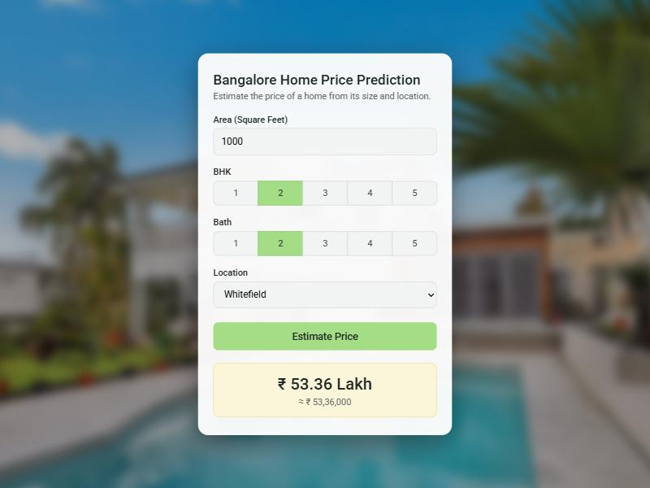

# Bangalore Home Price Prediction

A machine learning web app that estimates the price of a home in Bangalore, India, from its area, number of bedrooms (BHK), number of bathrooms and location.

**🔗 Live demo: [najat.pythonanywhere.com](https://najat.pythonanywhere.com/)**



## Features

- Price estimate in lakh and in full rupees (e.g. ₹ 83.5 Lakh ≈ ₹ 83,50,000)
- 241 Bangalore locations to choose from
- Input checks with clear error messages
- Responsive design that works on phones
- REST API that can be used without the web page

## How it works

```
Browser ──► Flask (server.py)
              ├── /                          → the web page (client/)
              ├── /api/get_location_names    → list of locations
              └── /api/predict_home_price    → util.py → trained model → estimated price
```

1. **Data**: the [Bengaluru House Price dataset](https://www.kaggle.com/datasets/amitabhajoy/bengaluru-house-price-data) (13,320 listings).
2. **Cleaning** (`notebook.ipynb`):
   - dropped unused columns and rows with missing values;
   - extracted the number of bedrooms from text such as "2 BHK" or "4 Bedroom";
   - converted area ranges such as "2100 - 2850" to their average;
   - grouped locations with 10 listings or fewer under "other" (1,304 → 242 locations);
   - removed outliers: homes with less than 300 sqft per bedroom, prices per sqft far from their location's average, and homes with more bathrooms than bedrooms + 2.

   The cleaned dataset has 7,251 rows.
3. **Model**: locations are one-hot encoded, then three models are compared with GridSearchCV and 5-fold cross-validation:

   | Model | Mean R² score |
   |---|---|
   | **Linear Regression** | **0.82** |
   | Decision Tree | 0.72 |
   | Lasso | 0.69 |

   Linear Regression was kept (R² = 0.85 on the test set) and saved in `model/`.
4. **API**: a Flask server loads the model and answers prediction requests.
5. **Frontend**: an HTML/CSS/JavaScript page that calls the API.

## Project structure

```
bangalore-house-prices/
├── client/               # Frontend
│   ├── app.html
│   ├── app.css
│   └── app.js
├── server/               # Backend
│   ├── server.py         # Flask routes, also serves the frontend
│   ├── util.py           # Loads the model, makes predictions
│   └── requirements.txt
├── model/
│   ├── banglore_home_prices_model.pickle   # Trained model
│   └── columns.json                        # Model input columns (incl. locations)
├── data/
│   └── Bengaluru_House_Data.csv
└── notebook.ipynb        # Data cleaning and model training
```

## Run it locally

Requires Python 3.11.

```bash
git clone https://github.com/najato8/bangalore-house-prices.git
cd bangalore-house-prices
pip install -r server/requirements.txt
python server/server.py
```

Then open http://127.0.0.1:5000.

## API

| Route | Method | Parameters | Response |
|---|---|---|---|
| `/api/get_location_names` | GET | — | `{"locations": ["1st block jayanagar", ...]}` |
| `/api/predict_home_price` | POST (form data) | `total_sqft`, `location`, `bhk`, `bath` | `{"estimated_price": 83.5}` |

Prices are in **lakh** (1 lakh = ₹100,000).

Example:

```bash
curl -X POST https://najat.pythonanywhere.com/api/predict_home_price \
  -d "total_sqft=1000" -d "location=1st Phase JP Nagar" -d "bhk=2" -d "bath=2"
```

## Deployment

Deployed on [PythonAnywhere](https://www.pythonanywhere.com/) (free plan): a virtualenv with the packages from `requirements.txt`, and a WSGI file that imports `app` from `server/server.py`.

## Tech stack

Python · pandas · NumPy · scikit-learn · Matplotlib · Flask · HTML/CSS/JavaScript · PythonAnywhere

## Acknowledgements

Based on the [codebasics](https://www.youtube.com/@codebasics) machine learning project tutorial series.
